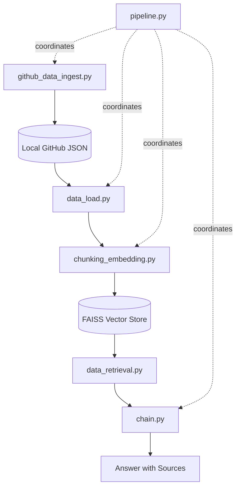

# Personal RAG

A modular, local Retrieval-Augmented Generation (RAG) system designed to answer questions about a person's technical background, projects, skills, and codebase by ingesting data from **GitHub** (profile, repositories, READMEs, source code) and optional **documents (e.g., CV / Resume PDF)**.

---

## 💡 The Idea

When representing a software engineer or developer, resumes only tell part of the story. Public code repositories, commit histories, project architectures, and actual implementations contain rich context. 

**Personal RAG** bridges this gap:
- It automatically pulls your public GitHub presence (profile details, repository metadata, README files, and selected source code files) along with your resume/CV PDF.
- It converts this heterogeneous data into searchable vector embeddings stored in a local **FAISS** vector database.
- When an inquiry is made (e.g., *"What technologies does Hamza specialize in?"* or *"Describe his computer vision projects"*), the system retrieves the most relevant context and synthesizes an accurate answer backed by source links.

---

## 🛠️ Tech Stack

| Component | Technology | Description |
| :--- | :--- | :--- |
| **Language** | Python 3.10+ | Core programming language |
| **Orchestration / RAG Framework** | LangChain (`langchain-core`, `langchain-community`, `langchain-classic`) | Document loading, chunking, retrieval, and conversational chain pipelines |
| **Vector Store** | **FAISS** (`faiss-cpu`) | Fast, local vector similarity search and index persistence |
| **Embeddings** | HuggingFace (`sentence-transformers/all-MiniLM-L6-v2`) | Local, high-performance dense vector embeddings running on CPU/GPU |
| **LLM Provider** | OpenRouter API (`ChatOpenAI` client) | Flexible access to models (e.g., `openrouter/free` or specified models) |
| **Document Loaders** | `PyPDFLoader` & Custom JSON Loaders | Parsing PDF resumes and local GitHub JSON dumps |
| **Configuration & Secrets** | `python-dotenv`, `pydantic` / `pathlib` | Environment variables and centralized configuration |
| **API Client** | `requests` | GitHub REST API interaction with authentication support |

---

## ⚙️ How It Works

The system operates across distinct phases:

1. **Data Ingestion (`github_data_ingest.py`)**:
   - Queries the GitHub REST API to fetch the user profile and all owned public repositories.
   - For each repository, it extracts metadata (stars, description, topics, language), the `README.md`, and key source code files (filtered by extensions like `.py`, `.js`, `.ts`, `.cpp`, etc., excluding build/cache artifacts).
   - Saves the structured data locally into JSON files under `data/github/<username>/`.

2. **Document Loading (`data_load.py`)**:
   - Loads the saved GitHub JSON files (profile, repository summaries, READMEs, source files) and creates standardized LangChain `Document` objects with rich metadata (source URLs, repo name, document type).
   - Loads any local PDF files (e.g., resume/CV) using `PyPDFLoader`.

3. **Chunking & Embedding (`chunking_embedding.py`)**:
   - Splits documents into manageable token chunks using `TokenTextSplitter` (configurable chunk size and overlap).
   - Generates vector representations using HuggingFace sentence transformers (`sentence-transformers/all-MiniLM-L6-v2`).
   - Indexes all embeddings into a local **FAISS** vector store and persists it to disk under `data/faiss_index/`.

4. **Retrieval (`data_retrieval.py`)**:
   - Exposes a similarity retriever interface (`as_retriever(k=...)`) to find the top $K$ most semantically relevant chunks for any incoming user prompt.

5. **Generation Chain (`chain.py`)**:
   - Sets up a conversational retrieval chain (`ConversationalRetrievalChain`) with conversation memory (`ConversationBufferMemory`) and a custom system prompt.
   - Passes context to the LLM via the OpenRouter endpoint to generate grounded answers accompanied by citations and source links.

6. **End-to-End Orchestration (`pipeline.py`)**:
   - Manages the complete lifecycle: coordinates building/loading the FAISS index and handling interactive questions.

---

## 🏗️ Architecture



---

## 📂 File Structure

```text
personal-RAG/
├── .env                              # Environment variables (API keys)
├── requirements.txt                  # Python dependencies
├── README.md                         # Project documentation
├── data/                             # Data directory (relative to root)
│   ├── HamzaEldafrawy.pdf            # Optional CV/Resume PDF
│   ├── github/                       # Ingested GitHub JSON files
│   │   └── <username>/
│   │       ├── profile.json
│   │       └── repositories/
│   │           └── <repo_name>.json
│   └── faiss_index/                  # Persisted FAISS vector index files
│       ├── index.faiss
│       └── index.pkl
└── src/
    └── personal_rag/                 # Main package
        ├── __init__.py               # Package marker (clean/empty)
        ├── config.py                 # Central configuration and root-relative paths
        ├── github_data_ingest.py     # GitHub API ingestion script
        ├── data_load.py              # PDF & JSON document loading
        ├── chunking_embedding.py     # Token splitting, embeddings & FAISS index
        ├── data_retrieval.py         # Vector similarity search and retriever setup
        ├── chain.py                  # OpenRouter LLM setup, prompts & memory chain
        └── pipeline.py               # End-to-end coordinator and CLI test entry point
```

---

## 🚀 How to Use Locally

### 1. Clone the Repository
```bash
git clone <repository-url>
cd personal-RAG
```

### 2. Set Up a Virtual Environment & Install Dependencies
```bash
python -m venv .venv

# On Windows:
.venv\Scripts\activate

# On Linux/macOS:
source .venv/bin/activate

pip install -r requirements.txt
```

### 3. Create the `.env` File
Create a `.env` file in the root directory of the project:
```dotenv
# Required: OpenRouter API Key for the LLM
OPENROUTER_API_KEY=your_openrouter_api_key_here

# Optional: GitHub Personal Access Token (avoids API rate limits for ingestion)
GITHUB_TOKEN=your_github_token_here
```

### 4. Configure Your Username & Files
Open `src/personal_rag/config.py` and customize the settings:
- **`GITHUB_USERNAME`**: Change to your target GitHub username:
  ```python
  GITHUB_USERNAME = "your-github-username"
  ```
- **`PDF_PATH`**: Set the name/path of your PDF resume inside the `data/` folder (or leave it if you do not have a PDF; the loader will skip it with a warning if not found).
- **Model Parameters**: Adjust `LLM_MODEL`, `CHUNK_SIZE`, `CHUNK_OVERLAP`, or `RETRIEVER_K` if desired.

---

## 📥 Ingesting vs. Loading GitHub Data

The project decouples **network fetching** from **local loading** for maximum speed and offline support:

### Approach:
1. **Fetching (Network Ingestion)**:
   - Run `github_data_ingest.py` to connect to GitHub's REST API and download profile information, repositories, READMEs, and key code files.
   - The data is structured and saved locally into `data/github/<username>/`.
   - **Caching mechanism**: By default, `ingest_github()` checks if the profile and repository JSON files already exist. If they do, it skips re-downloading them.
   - **Forcing a fresh fetch**: To refresh the data, set `force_fetch=True` in `ingest_github()` or clear the `data/github/<username>/` folder.

   Run ingestion via:
   ```bash
   python -m personal_rag.github_data_ingest
   ```
   *(Ensure your terminal is in the project root and `src` is in `PYTHONPATH`, or run with `python src/personal_rag/github_data_ingest.py`)*

2. **Loading (Offline / Fast)**:
   - When running the RAG pipeline (`pipeline.py`), `data_load.py` reads the already-saved local JSON files directly from disk without hitting the GitHub API or consuming rate limits.

---

## 💬 Running the Pipeline

To build the FAISS index and run queries against your personal knowledge base:

```bash
# Add src to PYTHONPATH if running directly
# On Windows (cmd):
set PYTHONPATH=%cd%\src
python src\personal_rag\pipeline.py

# On Windows (PowerShell):
$env:PYTHONPATH = "$PWD\src"
python src\personal_rag\pipeline.py

# Or run as a module:
python -m personal_rag.pipeline
```

### Python API Usage
You can also integrate the pipeline directly into scripts or notebooks:

```python
from personal_rag.pipeline import PersonalRAG

# Initialize and build the index (builds FAISS index or loads existing one)
rag = PersonalRAG().build()

# Query the system
result = rag.ask("What projects has Hamza built involving computer vision?")
print("Answer:", result["answer"])

# View retrieved source documents
for doc in result["source_documents"]:
    print(f"- Source: {doc.metadata.get('source')} (Type: {doc.metadata.get('type')})")
```

---

## 🛠️ Notes & Troubleshooting

- **FAISS Re-indexing**: If you update your GitHub data or replace your PDF resume, run `rag.build(force_reindex=True)` or delete the `data/faiss_index` folder to regenerate the embeddings.
- **GitHub Rate Limits**: GitHub limits unauthenticated requests to 60 per hour. Add a `GITHUB_TOKEN` to your `.env` file to increase this limit to 5,000 requests per hour.
- **Direct Sibling Imports**: All modules under `src/personal_rag/` use sibling imports (`from config import ...`, `from data_load import ...`). Always run commands from the project root with `src` in your `PYTHONPATH` or using `python -m personal_rag.<module_name>`.

